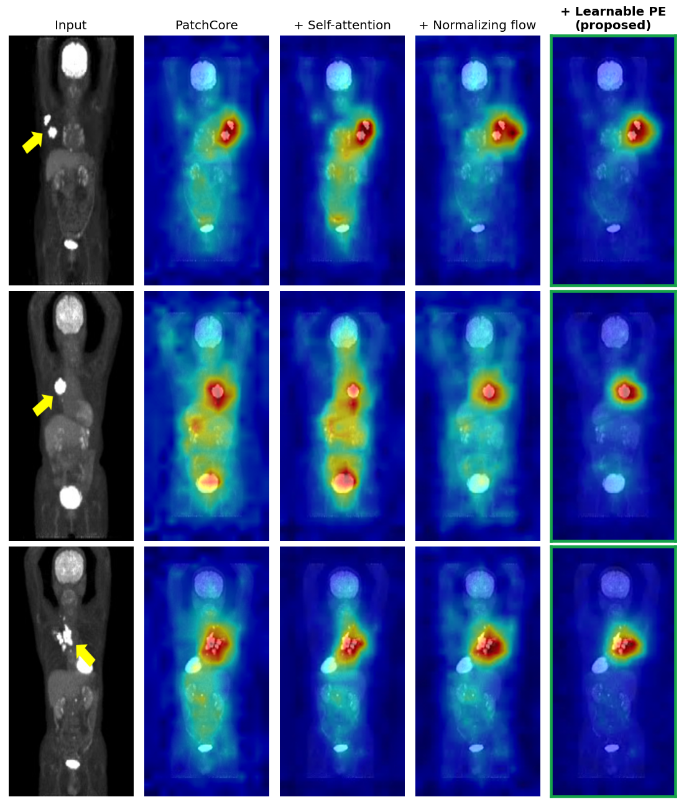
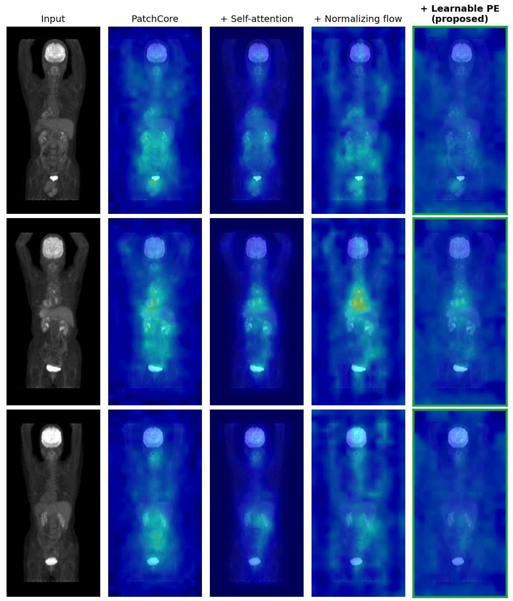
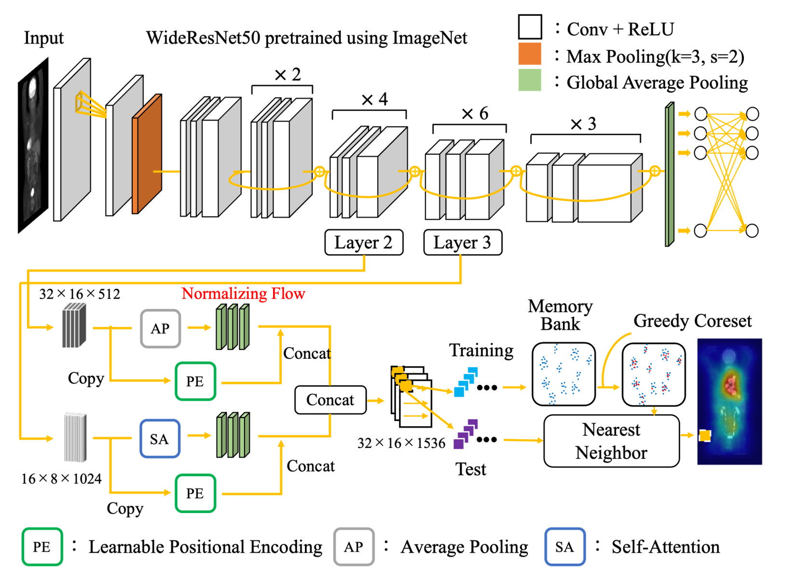
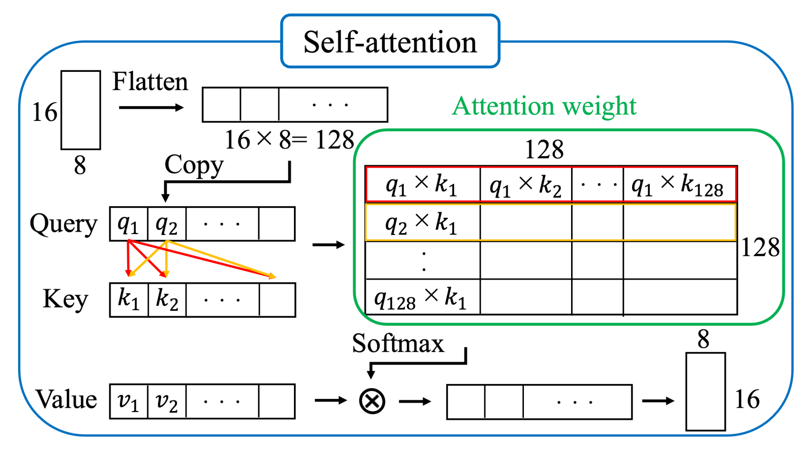
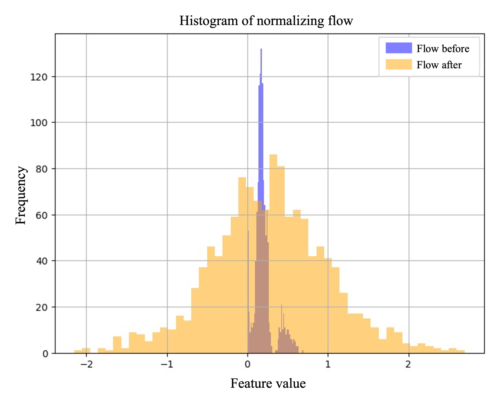
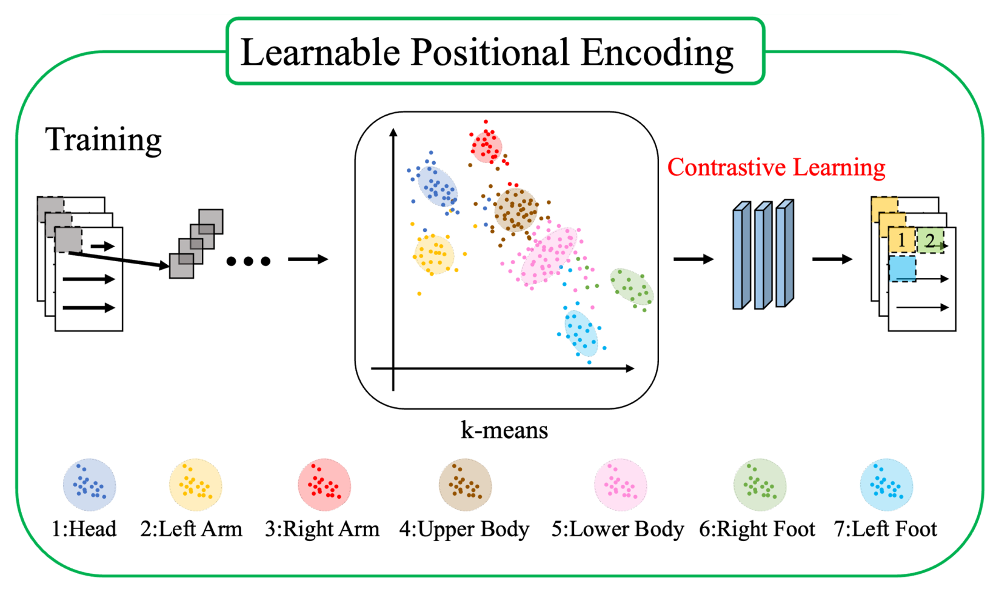
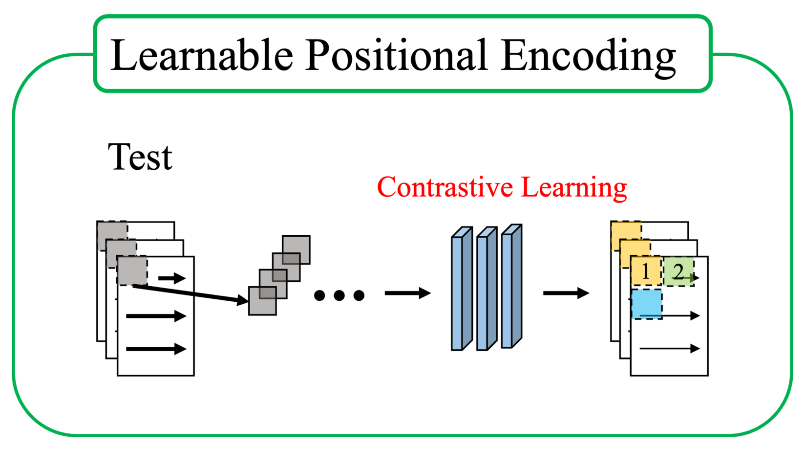
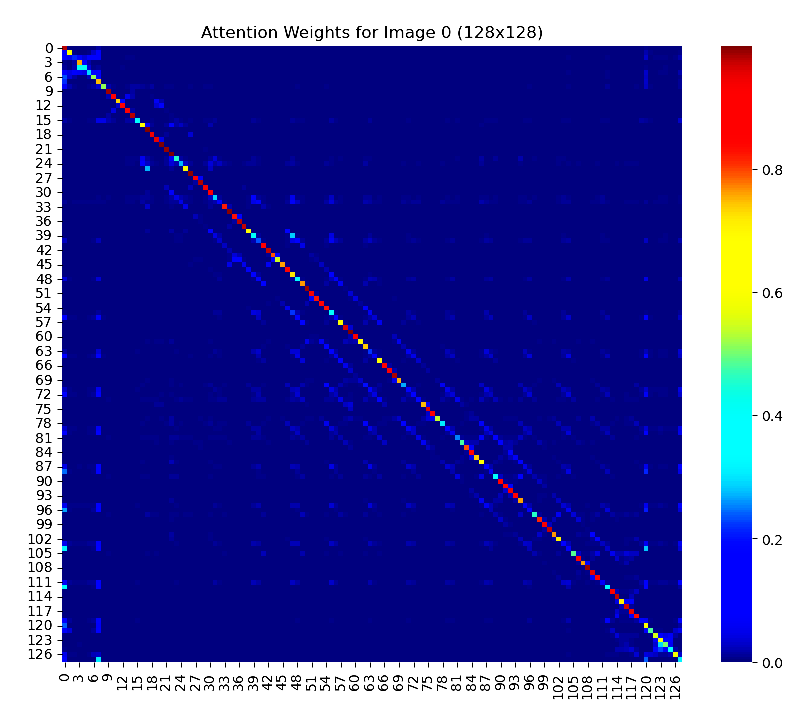

# Self-Attention PatchCore with Normalizing Flow

[](https://github.com/kura54/sa-patchcore-nf/actions/workflows/tests.yml)


Unsupervised cancer screening on whole-body FDG-PET. The model learns only from **normal** scans and flags anything it has not seen before, without lesion labels.

This is a cleaned-up version of my master's research code (2025). The method was presented at **NCSP'25, where it received the Student Paper Award**, and at IFMIA 2025.

| | Accuracy | Sensitivity | Specificity | AUROC |
| --- | :---: | :---: | :---: | :---: |
| PatchCore | 0.69 | 0.58 | 0.79 | 0.72 |
| + Self-attention | 0.70 | 0.61 | 0.78 | 0.74 |
| + Normalizing flow | **0.73** | 0.71 | 0.75 | 0.77 |
| + Learnable positional encoding (**proposed**) | **0.73** | **0.72** | 0.74 | **0.80** |

<sub>Test set of 165 normal and 165 abnormal patients. Each row adds one component to the row above. Numbers are from the original experiments; the clinical data is private and is not part of this repository.</sub>

<p align="center"></p>

<sub>Anomaly maps for three abnormal cases (red = more anomalous; arrows mark the lesions). All four models find the lesion. Going left to right, the score on normal tissue drops: PatchCore lights up the bladder and abdomen as much as the tumour in the middle row, while the proposed model keeps them close to background.</sub>

<details>
<summary>Normal cases</summary>
<br>
<p align="center"></p>

<sub>Same models on three normal patients. The proposed model gives the flattest maps, with the least response around the chest and abdomen.</sub>
</details>

## The problem

PET screening produces a whole-body scan per patient, and radiologists read every one of them looking for small hot spots. Supervised detectors need thousands of annotated lesions of every type. Normal scans are easy to collect.

PatchCore, a strong anomaly detector for industrial inspection, works on that premise: store patch features of normal images, then score each test patch by its distance to the nearest stored one. Out of the box it does poorly on PET, for three reasons:

1. **Normal is position-dependent.** High FDG uptake is normal in the brain, heart and bladder but suspicious in the lung. PatchCore treats every patch independently.
2. **The feature space is messy.** Bodies vary in size and physiology, so normal features form a skewed, multi-modal distribution, and Euclidean distance in it is a poor anomaly score.
3. **Organs move.** A fixed grid position does not mean the same organ in a tall and a short patient.

Each component below targets one of these.

## Method

<p align="center"></p>


**Input.** One maximum-intensity projection (MIP) per patient, rendered from the front of the 3D PET volume and resized to 256 x 128. Intensities are scaled to [0, 1] and repeated to three channels for the ImageNet backbone.

**Self-attention on layer3** ([`layers.py`](src/sapc/layers.py)). Every position in the coarse feature map becomes a weighted mix of all positions, so a patch carries context from the rest of the body: "bright spot, and the brain is up there" rather than just "bright spot".

<p align="center"></p>

**Conditional normalizing flow** ([`flow.py`](src/sapc/flow.py)). Each patch vector, concatenated with a 2D sine-cosine positional code, passes through 25 affine coupling blocks (FrEIA `AllInOneBlock`) trained to map normal patches to a standard Gaussian. The positional code is also fed to every block as a condition, as in CFLOW-AD. In the Gaussianised space, nearest-neighbour distances mean the same thing everywhere in the body. This gave the largest single gain, mostly in sensitivity (0.61 to 0.71).

<p align="center"><br><sub>One feature channel before (blue) and after (orange) the flow.</sub></p>

**Learnable positional encoding** ([`lpe.py`](src/sapc/lpe.py)). A sine-cosine code says where a patch sits on the grid, not which organ it shows. Instead:

1. Cluster all normal training patches with k-means (k = 7). k = 7 was chosen to roughly match head, both arms, upper body, lower body and both legs.
2. Train a small MLP on `[feature, one_hot(cluster)]` with a supervised InfoNCE loss: patches from the same cluster are positives, the rest of the batch are negatives (temperature 0.07).
3. Append the 256-d MLP output to the flow output before the memory bank. At test time no clustering is run; the MLP gets a uniform cluster code and relies on the features alone.

<p align="center"><br></p>

The code clusters by anatomy, not by coordinates, so it follows the organ when the body shifts. Qualitatively this suppressed the false positives around the chest and abdomen, and AUROC went from 0.77 to 0.80.

**Scoring** ([`model.py`](src/sapc/model.py), [`coreset.py`](src/sapc/coreset.py)). The memory bank is reduced to 40% with greedy k-center selection. A test patch's score is the L2 distance to its nearest memory-bank vector, and the image score is the maximum over patches. The threshold maximises Youden's J.

## Findings worth sharing

- **The self-attention was nearly an identity map.** Visualising the attention weights showed almost all mass on the diagonal. The attention has no learnable projections and, as in the original code, no `1/sqrt(C)` scaling. With C = 1024 the raw dot products are huge, so the softmax becomes one-hot. That explains why attention alone gave only +0.02 AUROC.

  
 This repository adds `model.attention_scale: true` to fix the scaling; I have not been able to re-run it on the clinical data, so treat it as an untested idea.
- **Distribution shape mattered more than context.** The normalizing flow helped more than attention. Feature histograms before and after the flow went from skewed to close to Gaussian.
- **The threshold is optimistic.** As in the thesis, it is picked on the test scores themselves. AUROC is unaffected, but accuracy, sensitivity and specificity would be lower with a threshold fixed on the validation split.

## Notes on this rewrite

The original code lived in a series of dated Jupyter notebooks. While turning it into a package I changed the following. The first three are bug fixes.

| Change | Why |
| --- | --- |
| Memory-bank vectors for the flow model are reshaped with `permute` before flattening | One notebook flattened `(B, C, H, W)` with `reshape`, mixing channels and positions for training patches only, so train and test vectors were laid out differently |
| k-means and the LPE MLP see the same backbone features during fitting and scoring | k-means was fitted on post-attention layer3 features but applied to pre-attention ones |
| Region masks are rotated together with the image in `feature_atlas.py` | The LabelMe polygons were drawn on the unrotated MIP while the image was flipped 180 degrees |
| 16-bit MIPs are read at full precision | `cv2.IMREAD_COLOR` silently cut them to 8 bits |
| One `PatchCoreModel` with config switches for all four rows of the table | Four near-copies of the same notebook |
| InfoNCE is vectorised | Replaces a per-anchor Python loop over each 512-sample batch |
| faiss is skipped on macOS (`search_backend: auto`) | faiss-cpu and PyTorch ship different OpenMP runtimes and segfault together; the notebooks hid this with `KMP_DUPLICATE_LIB_OK` |

Because the data cannot leave the hospital network, I could not re-run the full experiments after the rewrite. The code is covered by unit tests and an end-to-end run of every variant on synthetic images (see `tests/`), and the table above comes from the original notebooks.

## Usage

```bash
git clone https://github.com/kura54/sa-patchcore-nf.git
cd sa-patchcore-nf
pip install -e ".[dev]"
```

Put your images in this layout (8- or 16-bit, single channel):

```
data/
  train/normal/*.tif
  test/normal/*.tif
  test/abnormal/*.tif
```

Run one row of the table:

```bash
python scripts/run.py --config configs/sa_patchcore_nf_lpe.yaml --maps
```

Any config value can be overridden from the command line:

```bash
python scripts/run.py --config configs/patchcore.yaml --set data.root=/path/to/data coreset.ratio=0.1
```

Each run writes to `outputs/<name>/`: `metrics.json`, per-image `scores.csv`, a score histogram, the trained `model.pt`, and with `--maps` one anomaly-map overlay per test image sorted into `TP/FP/TN/FN` folders.

To check what the learnable encoding learned, project the patch embeddings and colour them by annotated body region:

```bash
python scripts/feature_atlas.py --config configs/sa_patchcore_nf_lpe.yaml \
    --checkpoint outputs/sa_patchcore_nf_lpe/model.pt --annotations path/to/labelme_jsons
```


## Repository layout

```
configs/                 one YAML per ablation row
scripts/run.py           fit + evaluate + save
scripts/feature_atlas.py t-SNE / UMAP of embeddings by body region
src/sapc/
  backbone.py            frozen WideResNet-50-2, layer2 + layer3
  layers.py              self-attention, 2D positional encoding, patch helpers
  flow.py                conditional normalizing flow and its loss
  lpe.py                 k-means + InfoNCE learnable positional encoding
  coreset.py             greedy k-center subsampling
  model.py               the full pipeline
  metrics.py             AUROC and Youden-threshold metrics
  visualize.py           anomaly-map overlays
tests/                   unit tests and a synthetic end-to-end test
```

## Data and privacy

The study used a private clinical dataset of 1,360 whole-body FDG-PET screening exams (1,030 normal, 330 abnormal). No images, annotations, model weights or patient-level results are included here, and `.gitignore` blocks common medical image and checkpoint formats.

## Publications

- *Anomaly Detection for PET Images Using Self-Attention PatchCore with Normalizing Flow*. International Workshop on Nonlinear Circuits, Communications and Signal Processing (NCSP'25), Penang, March 2025. **Student Paper Award.**
- *Anomaly Detection for PET Images Using PatchCore with Normalizing Flow and Learnable Positional Encoding*. International Forum on Medical Imaging in Asia (IFMIA 2025), Kagawa, March 2025.

This work was partially supported by JSPS KAKENHI Grant Number JP24K15776.

## References

- K. Roth et al. Towards Total Recall in Industrial Anomaly Detection (PatchCore). CVPR 2022.
- D. Gudovskiy et al. CFLOW-AD: Real-Time Unsupervised Anomaly Detection with Localization via Conditional Normalizing Flows. WACV 2022.
- L. Ardizzone et al. FrEIA: Framework for Easily Invertible Architectures.
- P. Khosla et al. Supervised Contrastive Learning. NeurIPS 2020.

## License

MIT
